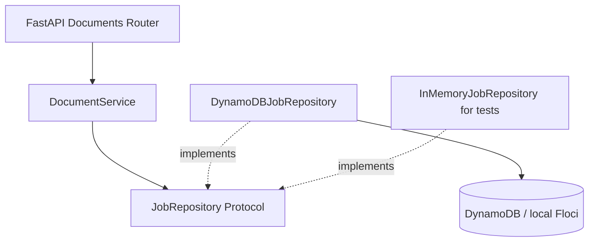

# EventDriven Document Processor

An event-driven document-processing API built with Python and FastAPI. The system is designed to accept direct S3 uploads, process documents asynchronously, and expose job status without coupling HTTP request handling to background processing.

## Implemented

- Versioned REST API with FastAPI and Pydantic validation
- Document job creation with UUID identifiers and UTC timestamps
- Job retrieval with explicit `404` and `422` responses
- Modular application, domain, and infrastructure boundaries
- Repository contract and dependency injection
- DynamoDB persistence through boto3, with Floci for local development
- Docker Compose API, persistent Floci storage, and automatic table initialization
- Validated environment settings, bounded SDK retries/timeouts, and sanitized storage errors
- In-memory persistence for isolated unit and HTTP contract tests
- Unit, HTTP contract, and opt-in Floci integration tests

The current application creates **metadata-only jobs**. Files are not uploaded or processed yet.
S3, queues, workers, deduplication, and callbacks are not implemented. No real AWS deployment
is included. See [project status](docs/PROJECT_STATUS.md) for actual verification results.

## Requirements

- Python 3.14+
- [uv](https://docs.astral.sh/uv/)
- Docker Engine / Docker Desktop with Linux containers and Docker Compose v2

## Run

```sh
docker compose up --build -d --wait api
```

This starts Floci 2.4.0, waits for its healthcheck, runs the one-shot DynamoDB bootstrap,
then starts the non-root API container. The initializer can run repeatedly without clearing
jobs and rejects incompatible table schemas. Only `127.0.0.1:8000` is published; Floci is
reachable only within the Compose network. No Docker socket or AWS profile is mounted.

API documentation: http://127.0.0.1:8000/docs

```sh
uv sync
uv run pytest
uv run ruff check .
docker compose config --quiet
```

The default test run needs no AWS or Docker: it uses in-memory repositories and SDK stubs.
The lockfile includes runtime and development dependencies; images install with `uv sync --frozen`.

### Configuration

Copy `.env.example` to `.env` only if you need to override Compose defaults. Pydantic Settings
reads the application's process environment; it does not load `.env` itself. Compose supplies:

- `AWS_ENDPOINT_URL=http://floci:4566` inside containers; omit the override for real AWS.
- `AWS_DEFAULT_REGION=us-east-1` and `DYNAMODB_TABLE_NAME=document-jobs`.
- `AWS_CONNECT_TIMEOUT=2` and `AWS_READ_TIMEOUT=3` (seconds; each must be greater than 0, at most 30).
- `AWS_MAX_ATTEMPTS=3` (total SDK attempts, including the first; permitted range 1–5).
- `LOG_LEVEL=INFO`; SDK wire/debug logging remains disabled even at application `DEBUG`.
- `API_PORT=8000` controls the localhost published port, not the container's listening port.

Compose intentionally uses dummy `local` credentials instead of inheriting host credentials.
Outside Compose, boto3 uses its standard credential provider chain, including environment
credentials or workload roles. Never put real credentials in source, `.env.example`, or images.
Runtime configuration/wiring lives in `bootstrap/`; local provisioning lives in `infra/local/`.
For host-based API development, explicitly configure a reachable local endpoint, region, and
dummy credentials before `uv run fastapi dev`; Floci has no published port by default.

### Floci integration and persistence verification

```sh
docker compose --profile test run --build --rm tests
docker compose --profile test run --rm tests uv run --no-sync ruff check .
uv run python infra/local/verify_persistence.py
```

The test service opts into Floci tests via `RUN_FLOCI_TESTS=1`. Tests create unique
`document-jobs-test-*` tables, repeat initialization, exercise boto3 and HTTP round trips,
and delete only their own tables. Explicitly selected Floci tests fail rather than silently
skip if their configured endpoint is unavailable. Do not point them at a real AWS account.

The persistence script starts/builds the stack, creates a job over HTTP, restarts the API,
recreates the Floci container, reruns bootstrap, and verifies identical job responses.
It leaves the stack, volume, and verification job intact. Set `API_PORT` in the invoking
shell too if you changed the port in `.env` (the script reads process environment).

Floci runs with `FLOCI_STORAGE_MODE=persistent` and
`FLOCI_STORAGE_PERSISTENT_PATH=/app/data`, backed by the `floci-data` named volume.
`docker compose down` retains this data. **`docker compose down --volumes` deletes local jobs**;
use it only when intentionally resetting development data. Emulator persistence is not an
AWS durability or backup guarantee.

## API

### Create a document job

`POST /api/v1/documents`

```json
{
  "filename": "contract.pdf",
  "content_type": "application/pdf",
  "description": "Signed contract"
}
```

**201 Created**

```json
{
  "job_id": "550e8400-e29b-41d4-a716-446655440000",
  "filename": "contract.pdf",
  "content_type": "application/pdf",
  "description": "Signed contract",
  "status": "PENDING",
  "created_at": "2026-11-05T15:00:00Z"
}
```

The `job_id` and `created_at` values are generated on each request. `filename` is the canonical request field; `file_name` is also accepted for compatibility with earlier clients.

### Retrieve a job

`GET /api/v1/documents/{job_id}`

- `200 OK` — matching job
- `404 Not Found` — valid UUID without a matching job
- `422 Unprocessable Content` — malformed UUID or invalid request

Storage outages return a sanitized `503`; unreadable stored records return a sanitized `500`.
Storage failures are never reported as `404`. Existing success, validation, and alias contracts
are unchanged. `POST` remains non-idempotent: a client retry may create another job if the
original write succeeded but its response was lost.

### Health check

`GET /health`

## Design



The HTTP layer owns request validation and response schemas. The application service coordinates the creation and retrieval of jobs. Domain models remain independent of FastAPI and storage providers. The repository contract separates persistence requirements from the implementation.

The runtime repository uses a shared low-level boto3 client and strongly consistent reads.
The DynamoDB table has one string partition key, `pk`, containing `JOB#{job_id}`. UUIDs,
statuses, and timezone-aware timestamps are mapped inside the adapter. `HASH#{sha256}` is
reserved for future duplicate detection; no hash items are created in this milestone.
The `JobRepository` Protocol and domain remain storage/framework independent.

See [the storage decision](docs/decisions/0001-local-dynamodb.md) and
[repository guidance](AGENTS.md). The IAM templates in `infra/iam/` require replacing
`REGION`, `ACCOUNT_ID`, and `TABLE_NAME` before use. Runtime access is restricted to
`GetItem`/`PutItem` on `JOB#*` keys in one table; bootstrap uses `CreateTable`/`DescribeTable`
separately. These policies are examples, not deployed policies. Floci's dummy credentials
are not evidence of real AWS IAM enforcement. Integration tests additionally need table
creation/deletion permissions and must remain isolated from development/production data.

## Next capabilities

1. Presigned S3 uploads and S3 event notifications
2. SQS-driven Lambda/worker processing and document validation
3. SHA-256 deduplication, idempotency, retries, and DLQ
4. Reliable webhook delivery, expanded observability, and CI

No AWS infrastructure has been deployed.
