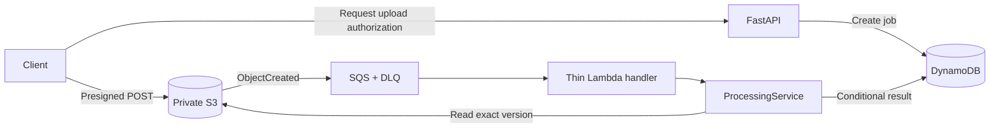

<div align="center">

# EventDriven Document Processor

### Direct uploads. Version-pinned processing. Retry-safe events.

A Python backend exploring reliable document processing with an AWS-compatible event pipeline.

[](https://www.python.org/)
[](https://fastapi.tiangolo.com/)
[](docs/PROJECT_STATUS.md)
[](.github/workflows/ci.yml)

[Quick start](#quick-start) · [Architecture](#architecture) · [Test evidence](docs/PROJECT_STATUS.md) · [Development guide](docs/DEVELOPMENT.md)

</div>

## Overview

Create document jobs, upload files directly to private S3 storage, and validate **PDF, PNG and JPEG**
content asynchronously through **S3 → SQS → Lambda → DynamoDB**.

**Implemented and tested locally with Floci.** The event pipeline is opt-in; the default stack
provides the API and uploads only. No AWS deployment or successful hosted CI/release run is claimed.

## Why this project matters

An upload is easy. Handling duplicate events, overwritten objects and crashed workers is harder.
This project focuses on those backend engineering problems:

- **Correctness under retries** — conditional claims, leases and fencing tokens protect job results.
- **Clear boundaries** — one processing use case serves the Lambda adapter without framework coupling.
- **Evidence over demos** — real upload/event tests exercise native decoders, recovery and DLQ delivery.

## Tech stack

**API & configuration**<br>


**Events & storage**<br>


**Frontend**<br>


**Local tooling & quality**<br>


Native content validation uses **pikepdf/qpdf** and **Pillow**, packaged for Linux Python 3.14 Lambda.

## Architecture



**Clean Architecture:** API/event adapters → application → domain; infrastructure implements ports,
with concrete dependencies wired in `bootstrap/`. The first successfully claimed S3 version wins.
See the [design decisions](docs/decisions/) for concurrency and security tradeoffs.

## Core features

- **Private direct uploads:** short-lived POST policies bind object key, declared MIME type and size.
- **Browser upload client:** a minimal React single-page interface with drag-and-drop, client-side
  validation, real presigned-POST progress and live job-status tracking
  ([frontend guide](frontend/README.md)).
- **Version-fenced processing:** exact-version reads, bounded streaming and SHA-256 hashing.
- **Real content validation:** malformed or mismatched documents become `FAILED`, not false successes.
- **Resilient event delivery:** nested-record handling, partial batch failures, retries and a DLQ.
- **Persistent local jobs:** DynamoDB adapter, repeatable bootstrap and backward-compatible API contracts.
- **Isolated CI gates:** locked dependencies, lint/format checks, Docker builds and real event tests.
- **Tag-driven delivery:** reuse CI before publishing the production API image to GHCR.

> **Development only:** the API has no authentication, ownership checks, quotas or rate limits.
> Keep it local. Format validation is not malware scanning; production security remains future work.

## Quick start

**Prerequisites:** Docker with Linux containers and Compose. For Python tooling, use **Python 3.14**
and **uv 0.13.6**; the isolated CI runner requires **Compose ≥ 2.24.4**.

```sh
docker compose up --build -d --wait api
```

Open **[Swagger UI → localhost:8000/docs](http://localhost:8000/docs)**.
The default stack uses dummy credentials and retains local data in a named volume.

- `POST /api/v1/documents` — create a metadata-only job.
- `POST /api/v1/documents/uploads` — create a job and obtain direct-upload authorization.
- `GET /api/v1/documents/{job_id}` — retrieve job status.

**Want the full event pipeline?** Follow the [event-stack guide](infra/events/README.md): it runs
separately on API **8001** / gateway **4567**. Only its trusted emulator receives the Docker socket.

**Prefer a browser?** Start the API, then run `cd frontend && npm ci && npm run dev` and open
**[localhost:5173](http://localhost:5173)**. The client uploads through the presigned flow above and
tracks live processing status until completion; see the [frontend guide](frontend/README.md) for
commands and CORS details.

Configuration, upload examples, host development and persistence checks live in the
[development guide](docs/DEVELOPMENT.md). Stop normally with `docker compose stop`; do not delete
volumes unless you intentionally want to lose local data.

## Quality and testing

```sh
uv sync --locked
uv run python infra/ci/run.py quality  # Offline pytest, Ruff lint and full formatting
uv run python infra/ci/run.py docker   # Isolated builds, Floci, compatibility and event tests
```

**Recorded local evidence:** 331 isolated regression passes, 5 Lambda compatibility passes and
9 real event-chain passes. One strict SSE-metadata xfail records a Floci limitation; it is not proof
of encryption at rest. Offline runs intentionally skip emulator-dependent tests.

GitHub Actions is configured for PRs and `master` pushes with pinned actions, read-only permissions
and bounded jobs. [CI reproduction/security notes](infra/ci/README.md) explain cleanup and sanitized
logs; [project status](docs/PROJECT_STATUS.md) distinguishes local results from hosted verification.

## Documentation links

- [Development guide](docs/DEVELOPMENT.md) — setup, configuration, API examples and processing details.
- [Frontend](frontend/README.md) — React upload interface, networking/CORS and testing.
- [Event stack](infra/events/README.md) — real S3/SQS/Lambda setup and verification.
- [CI guide](infra/ci/README.md) — isolated gates, trust boundaries and GitHub settings.
- [Release guide](infra/release/README.md) — version tags, GHCR digests and publication safeguards.
- [Architecture decisions](docs/decisions/) — storage, uploads, processing, events and CI.
- [Project status](docs/PROJECT_STATUS.md) · [Changelog](CHANGELOG.md) — evidence and milestone history.

## Future improvements

- Authentication, ownership checks, quotas and rate limiting before public exposure.
- Hosted CI/release verification and real AWS IAM, encryption, load and failure testing.
- Cross-document SHA-256 deduplication — separate from implemented event idempotency.
- Reliable webhooks, expanded observability and operator-assisted DLQ recovery tooling.

These are planned improvements, **not current features**.
