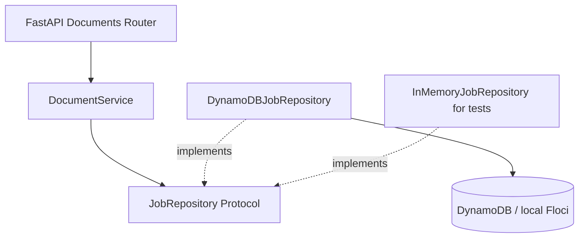

# EventDriven Document Processor

An event-driven document-processing API built with Python and FastAPI. The system is designed to accept direct S3 uploads, process documents asynchronously, and expose job status without coupling HTTP request handling to background processing.

## Continuous integration

The GitHub Actions workflow is configured for pull requests and default-branch (**master**) pushes:
Python 3.14/locked uv dependencies, pytest, full Ruff lint/format checks, Docker builds and isolated Floci/
native Lambda event gates. No production credentials, deployment or image publishing is involved.
See [CI instructions](infra/ci/README.md) for local reproduction, safe cleanup, fork security,
sanitized-log tradeoffs, and required manual GitHub settings. Hosted-run evidence is tracked in
[project status](docs/PROJECT_STATUS.md), separately from local checks.

## Implemented

- Versioned REST API with FastAPI and Pydantic validation
- Document job creation with UUID identifiers and UTC timestamps
- Job retrieval with explicit `404` and `422` responses
- Modular application, domain, and infrastructure boundaries
- Repository contract and dependency injection
- DynamoDB persistence through boto3, with Floci for local development
- Docker Compose API, persistent Floci storage, and automatic table initialization
- Validated environment settings, bounded SDK retries/timeouts, and sanitized storage errors
- In-memory persistence for isolated unit and HTTP contract tests
- Unit, HTTP contract, and opt-in Floci integration tests
- Direct private S3 uploads using short-lived presigned POST policies
- Shared processing core with conditional leases, exact-version reads, SHA-256 and format validation
- Opt-in S3 → SQS → thin Python 3.14 Lambda integration in the explicit Lambda Compose overlay

The original creation endpoint still creates **metadata-only jobs**. The new upload endpoint
creates pending jobs and authorization for direct S3 uploads. Uploads do not automatically trigger
processing in the normal stack. The separate [event stack](infra/events/README.md) installs S3/SQS
delivery and a thin Lambda adapter around the shared core. Deduplication and callbacks are not
implemented. No real AWS deployment
is included. See [project status](docs/PROJECT_STATUS.md) for actual verification results.

**Local development only:** authorization issuance has no authentication, ownership checks,
quotas, or rate limits. Do not expose this stack publicly; a private bucket alone does not
prevent an unauthenticated caller from obtaining upload authorization.

## Requirements

- Python 3.14+
- [uv](https://docs.astral.sh/uv/)
- Docker Engine / Docker Desktop with Linux containers and Docker Compose v2

## Run

```sh
docker compose up --build -d --wait api
```

This starts Floci 2.4.0, waits for its healthcheck, runs the one-shot DynamoDB/S3 bootstrap,
then starts the non-root API container. The initializer can run repeatedly without clearing
jobs and rejects incompatible table schemas. The API is published on `127.0.0.1:8000` and
Floci's shared AWS gateway on `127.0.0.1:4566` for host uploads. Neither is published on all
interfaces. No Docker socket or AWS profile is mounted. Existing named-volume data is retained.

API documentation: http://127.0.0.1:8000/docs

```sh
uv sync
uv run pytest
uv run ruff check .
docker compose config --quiet
```

The default test run needs no AWS or Docker: it uses in-memory repositories and SDK stubs.
The lockfile includes runtime and development dependencies; images install with `uv sync --frozen`.

### Configuration

Copy `.env.example` to `.env` only if you need to override Compose defaults. Pydantic Settings
reads the application's process environment; it does not load `.env` itself. Compose supplies:

- `AWS_ENDPOINT_URL=http://floci:4566` inside containers; omit the override for real AWS.
- `AWS_DEFAULT_REGION=us-east-1` and `DYNAMODB_TABLE_NAME=document-jobs`.
- `AWS_CONNECT_TIMEOUT=2` and `AWS_READ_TIMEOUT=3` (seconds; each must be greater than 0, at most 30).
- `AWS_MAX_ATTEMPTS=3` (total SDK attempts, including the first; permitted range 1–5).
- `LOG_LEVEL=INFO`; SDK wire/debug logging remains disabled even at application `DEBUG`.
- `API_PORT=8000` controls the localhost published port, not the container's listening port.
- `S3_INTERNAL_ENDPOINT_URL=http://floci:4566` is used for provisioning/internal operations.
- `S3_PUBLIC_ENDPOINT_URL=http://localhost:4566` is used to generate host-facing authorization.
  Generated URLs are never rewritten. Container tests instead sign for `http://floci:4566`.
- `S3_BUCKET_NAME=document-uploads` names a dedicated private quarantine bucket.
- `UPLOAD_MAX_FILE_SIZE_BYTES=10485760` (10 MiB) and `UPLOAD_EXPIRES_IN_SECONDS=300`
  (configurable 1–900 seconds). Expiration may occur earlier if signing credentials expire.
- `UPLOAD_ALLOWED_CONTENT_TYPES=["application/pdf","image/png","image/jpeg"]` may narrow
  supported types. It does not change the legacy metadata endpoint's validation.
- `S3_CORS_ALLOWED_ORIGINS=[]` disables browser cross-origin uploads by default. To enable a
  browser client, explicitly set origins such as `["http://localhost:3000"]`; no wildcard,
  credentials in origins, paths, query strings, or trailing slash. Only POST is permitted.
  This configures S3 CORS only; use a same-origin API/proxy for issuing authorization, since
  cross-origin FastAPI access has not been enabled in this milestone.

Compose intentionally uses dummy `test/test` credentials instead of inheriting host credentials,
with `FLOCI_SERVICES_S3_ENFORCE_AUTH=true`. Do not disable authentication to fix failing tests.
Outside Compose, boto3 uses its standard credential provider chain, including environment
credentials or workload roles. Never put real credentials in source, `.env.example`, or images.
Runtime configuration/wiring lives in `bootstrap/`; local provisioning lives in `infra/local/`.
For host-based API development, explicitly configure a reachable local endpoint, region, and
dummy `test/test` credentials before `uv run fastapi dev`. Both host S3 endpoints should be
`http://localhost:4566`; do not use the Docker hostname in browser-facing authorization.

### Floci integration and persistence verification

```sh
docker compose --profile test run --build --rm tests
docker compose --profile test run --rm tests uv run --no-sync ruff check .
uv run python infra/local/verify_persistence.py
uv run python infra/local/verify_upload.py
```

The test service opts into Floci tests via `RUN_FLOCI_TESTS=1`. Tests create unique
`document-jobs-test-*` tables, repeat initialization, exercise boto3 and HTTP round trips,
and delete only their own tables. Explicitly selected Floci tests fail rather than silently
skip if their configured endpoint is unavailable. Do not point them at a real AWS account.
S3 tests use unique disposable buckets and real HTTP multipart/form-data uploads. Negative
tests cover exact file sizes, modified keys/types, tampered signatures/policies, expiration,
unsigned writes, and anonymous reads. They also demonstrate replay and untrusted MIME labels.
One strict expected-failure test records a Floci 2.4.0 gap: POST-created objects do not report
the bucket's default SSE encryption metadata. Bucket encryption configuration is tested, but
the emulator does not establish actual encryption at rest; verify that separately on AWS.

The persistence script starts/builds the stack, creates a job over HTTP, restarts the API,
recreates the Floci container, reruns bootstrap, and verifies identical job responses.
It leaves the stack, volume, and verification job intact. Set `API_PORT` in the invoking
shell too if you changed the port in `.env` (the script reads process environment).
The upload smoke test uses the actual API-issued localhost URL without rewriting it, verifies
anonymous denial, recreates Floci, reruns bootstrap, and checks retained job responses and
object bytes. Both smoke scripts leave verification jobs/objects and the named volume intact.

Floci runs with `FLOCI_STORAGE_MODE=persistent` and
`FLOCI_STORAGE_PERSISTENT_PATH=/app/data`, backed by the `floci-data` named volume.
`docker compose down` retains this data. **`docker compose down --volumes` deletes local jobs**;
use it only when intentionally resetting development data. Emulator persistence is not an
AWS durability or backup guarantee.

## API

### Create a document job

`POST /api/v1/documents`

```json
{
  "filename": "contract.pdf",
  "content_type": "application/pdf",
  "description": "Signed contract"
}
```

**201 Created**

```json
{
  "job_id": "550e8400-e29b-41d4-a716-446655440000",
  "filename": "contract.pdf",
  "content_type": "application/pdf",
  "description": "Signed contract",
  "status": "PENDING",
  "created_at": "2026-11-05T15:00:00Z"
}
```

The `job_id` and `created_at` values are generated on each request. `filename` is the canonical request field; `file_name` is also accepted for compatibility with earlier clients.

### Create a job and obtain direct-upload authorization

`POST /api/v1/documents/uploads`

```json
{
  "filename": "contract.pdf",
  "content_type": "application/pdf",
  "file_size_bytes": 12345,
  "description": "Signed contract"
}
```

Returns **201 Created**, with `Cache-Control: no-store`:

```json
{
  "job": {
    "job_id": "550e8400-e29b-41d4-a716-446655440000",
    "filename": "contract.pdf",
    "content_type": "application/pdf",
    "description": "Signed contract",
    "status": "PENDING",
    "created_at": "2026-11-07T15:00:00Z"
  },
  "upload": {
    "method": "POST",
    "url": "http://localhost:4566/document-uploads",
    "fields": {"key": "quarantine/<job-id>/<random-id>", "policy": "<policy>", "x-amz-signature": "<signature>"},
    "expires_in_seconds": 300
  }
}
```

The example abbreviates `fields`. Submit **every actual returned field unchanged**, then the
file, to the returned URL as `multipart/form-data`. Do not manually set the HTTP multipart
`Content-Type` header: the client must add its boundary. Browser example:

```javascript
const form = new FormData();
for (const [name, value] of Object.entries(result.upload.fields)) form.append(name, value);
form.append("file", file);
const response = await fetch(result.upload.url, { method: "POST", body: form });
if (!response.ok) throw new Error("S3 rejected the upload");
```

The declared size must be a positive JSON integer (not a boolean, string, or float), at most
the configured limit. S3 policy binds **the file bytes**, not the full multipart request size,
to that exact length and the exact declared Content-Type. Filename is display metadata only;
paths/control characters and client-supplied bucket/key/ACL controls are rejected.

An expired authorization requires creating a new upload job; there is no renewal or confirmation
endpoint. Authorizations are **replayable until expiration** and can overwrite the same object
with another payload satisfying the policy. Upload success does not change `PENDING` or prove
the document is valid: MIME metadata is untrusted. Explicit core processing checks format but
does not establish that quarantine objects are malware-free. Never log or share
authorization fields. S3 errors are returned by S3 directly, not translated by FastAPI.

### Retrieve a job

`GET /api/v1/documents/{job_id}`

- `200 OK` — matching job
- `404 Not Found` — valid UUID without a matching job
- `422 Unprocessable Content` — malformed UUID or invalid request

Storage outages return a sanitized `503`; unreadable stored records return a sanitized `500`.
Storage failures are never reported as `404`. Existing success, validation, and alias contracts
are unchanged. `POST` remains non-idempotent: a client retry may create another job if the
original write succeeded but its response was lost.

### Health check

`GET /health`

## Design



The HTTP layer owns request validation and response schemas. The application service coordinates the creation and retrieval of jobs. Domain models remain independent of FastAPI and storage providers. The repository contract separates persistence requirements from the implementation.

The runtime repository uses a shared low-level boto3 client and strongly consistent reads.
The DynamoDB table has one string partition key, `pk`, containing `JOB#{job_id}`. UUIDs,
statuses, and timezone-aware timestamps are mapped inside the adapter. `HASH#{sha256}` is
reserved for future duplicate detection; no hash items are created in this milestone.
The `JobRepository` Protocol and domain remain storage/framework independent.
Upload use cases depend on a narrow `UploadAuthorizer` Protocol, implemented by the boto3 S3
adapter. An optional frozen `S3ObjectReference` is saved with the initial job; old items missing
  that attribute remain readable. Signing URLs/policies/fields are never persisted. The existing
GET response intentionally does not expose the new internal object reference.

### Shared processing core (Milestone 4, Phase 2)

`bootstrap/processing.py:get_processing_service()` composes a transport-independent
`ProcessingService`. Call `process(job_id, S3ObjectReference(bucket, decoded_key), version_id)`
with the saved upload reference and a nonempty immutable S3 version. There is no processing
HTTP endpoint. Normal Compose still installs no event consumer; the explicit overlay adds the
notification/queue/Lambda integration described below.
The separate [Phase 1 Lambda probes](infra/compatibility/README.md) remain synthetic and unchanged.

- The unchanged `JobRepository.save/get` serves creation and snapshots; a separate
  `ProcessingStore` uses **conditional UpdateItem only** for all processing state changes.
- `PENDING → PROCESSING → COMPLETED`, or `PROCESSING → FAILED` for permanent content failures.
  Claims bind a UUID attempt token, exact version and lease. **First successfully claimed version
  wins**, not necessarily the first uploaded version. Later replay-created versions cannot replace it.
- Only the selected version can recover an expired claim with a new token. Completion/failure
  requires the current token, version, PROCESSING status and unexpired lease. Active/conflicting
  claims raise retryable errors; they are not reported as successful processing.
- Exact-version S3 reads use 64 KiB chunks, SHA-256 and size-bounded temporary disk staging.
  Streams and staged files close/clean up on success, rejection and infrastructure errors.
  New upload jobs persist declared length internally; legacy rows without it remain readable.
- Actual PDF, PNG and JPEG contents are validated with pikepdf/qpdf and Pillow in a deadline-bound
  child process. PDFs require a real page tree and valid syntax/streams, with recovery disabled;
  encrypted PDFs are rejected. Images require integrity verification and full decoding. Animated
  images, oversized dimensions, malformed/truncated files and mismatched formats are rejected.
- Optional processing metadata, hashes, lengths and fixed failure codes remain internal;
  **existing API response fields and `file_name` compatibility are unchanged**. Format validation
  is not malware scanning: JavaScript, embedded files and other dangerous content may remain.
- S3/DynamoDB failures do not mark a document FAILED. They propagate for retry; an interrupted
  claim remains PROCESSING until same-version recovery after expiry. No heartbeat or sweeper exists.
  SHA-256 records content identity only; no HASH# records or cross-document deduplication are created.

Pydantic Settings / Compose expose these processing defaults (also in `.env.example`):
`PROCESSING_MAX_FILE_SIZE_BYTES=10485760`, `PROCESSING_LEASE_SECONDS=180`,
`PROCESSING_READ_TIMEOUT_SECONDS=60`, `PROCESSING_VALIDATION_TIMEOUT_SECONDS=15`,
`PROCESSING_MAX_IMAGE_PIXELS=20000000`, `PROCESSING_MAX_IMAGE_DIMENSION=16384`,
`PROCESSING_MAX_PDF_PAGES=500`, `PROCESSING_MAX_PDF_OBJECTS=50000`.
The lease must exceed read plus validation budgets by more than ten seconds. Reads have a
cooperative overall deadline plus bounded SDK I/O timeouts; use synchronized UTC worker clocks.
Parser children additionally have a 512 MiB address-space limit and ten-second soft CPU budget
on Linux. Windows has decoder/dimension limits and the wall deadline, **not** POSIX memory/CPU
limits. This process boundary is not a security sandbox. Unexpected native crashes remain retryable.

Bootstrap now enables bucket versioning without deleting existing data or null versions.
Legacy null-version uploads are not processed implicitly: create a new upload to obtain a real
version. No migration, object scan, notification or development-data deletion is performed.
`infra/iam/processing-policy.json` is a separate, **undeployed** processor permissions example:
GetItem/UpdateItem on JOB# keys and GetObjectVersion on quarantine objects, without PutItem or
latest-object reads. Existing API privileges are not broadened; bootstrap adds PutBucketVersioning.

New tests live in `tests/unit/test_processing_*.py`, `tests/unit/test_document_validation.py`
and `tests/integration/test_processing_floci.py`. Integration tests use genuine generated files,
unique disposable tables/versioned buckets, barrier-coordinated races and explicit clocks rather
than lease sleeps. Run all Floci checks with the existing Compose test command above.
See [ADR 0003](docs/decisions/0003-shared-processing.md) for invariants and retry/packaging limits.

### Event integration (Milestone 4, Phase 3)

Use the [explicit event stack instructions](infra/events/README.md) to run on separate local
resources, with API port **8001** and authenticated S3 gateway **4567**. Normal development stays
on 8000/4566 and keeps its original volume. Only the trusted overlay emulator gets the Docker
socket; neither API nor test runner does. The overlay now has its own persistent lambda-data
volume. Stop services without deleting volumes when finished.

The event flow is API authorization → versioned private multipart POST → quarantine/ ObjectCreated
notification → source-scoped SQS processing queue → Lambda event-source mapping → thin handler →
existing ProcessingService → conditionally fenced DynamoDB result. All ObjectCreated variants,
including Post, are configured. `documents/events/s3_events.py` handles encoded keys, opaque version
IDs, nested records and S3 test notifications. Invalid events and poison bodies retry to the DLQ;
permanently invalid **documents** must become FAILED before their message can be acknowledged.

The handler returns ReportBatchItemFailures using only outer SQS IDs. One failed nested request
keeps its entire message retryable; successful nested jobs can safely replay. Active claims are
not acknowledged as completed. The first-successful-claim-wins policy, version-pinned reads and
all concurrency transitions remain in Phase 2, without duplicated business processing.

Default delivery settings: Lambda **150 s**, lease **180 s**, queue visibility **900 s**, **5 receives**
before DLQ, batch size **2**, batching window **0**, source retention **4 days**, DLQ **14 days**.
EventSettings rejects timeout/lease/visibility combinations that cannot safely recover a crashed
claim. A preflight budget check defers nested work that cannot fit in the remaining invocation.
No automatic DLQ replayer exists; malformed/oversized multi-record messages may require manual redrive.

`Dockerfile` builds the complete locked runtime dependency set in the pinned official Lambda Linux
Python 3.14 image and packages native shared libraries alongside the actual application. The private
versioned ZIP is outside quarantine/ and cannot recursively trigger processing. The bootstrap
preserves job/object versions and merges only its owned queue-policy Sid/notification ID. Serialize
control-plane bootstrap runs; S3 notification read/merge/write cannot arbitrate concurrent external
writers. IAM examples remain separate for API upload, processing/SQS consumption and provisioning.

```sh
docker compose -p eddp-lambda-probe -f compose.lambda.yaml --profile processing up --build -d processing-api
uv run python -m infra.events.verify
docker compose -p eddp-lambda-probe -f compose.lambda.yaml run --build --rm event-tests
docker compose -p eddp-lambda-probe -f compose.lambda.yaml stop processing-api lambda-floci
```

Event tests use dedicated disposable resources; normal upload fixtures remain isolated. Actual
results, native-runtime evidence and runtime limitations are in PROJECT_STATUS.md and
[ADR 0004](docs/decisions/0004-s3-sqs-lambda.md). Phase 4 adds CI separately; no GHCR publication.

See [the storage decision](docs/decisions/0001-local-dynamodb.md) and
[repository guidance](AGENTS.md). The IAM templates in `infra/iam/` require replacing
`REGION`, `ACCOUNT_ID`, and `TABLE_NAME` before use. Runtime access is restricted to
`GetItem`/`PutItem` on `JOB#*` keys in one table; bootstrap uses `CreateTable`/`DescribeTable`
separately. These policies are examples, not deployed policies. Floci's dummy credentials
are not evidence of real AWS IAM enforcement. Integration tests additionally need table
creation/deletion permissions and must remain isolated from development/production data.
Runtime signing additionally needs only `s3:PutObject` on `BUCKET_NAME/quarantine/*`; the
separate privileged verification inspector reads bytes only for testing. Bootstrap manages
the dedicated bucket's entire security configuration: all Block Public Access flags,
BucketOwnerEnforced, no bucket policy, SSE-S3, and explicit CORS. Do not point it at shared
buckets. It does not delete objects. See [the upload security ADR](docs/decisions/0002-secure-uploads.md).

## Next capabilities

1. Authentication, ownership checks, quotas, and rate limits before any public deployment
2. Publish the CI workflow and verify its first actual GitHub-hosted execution
3. Real AWS IAM, execution-role, encryption, load and failure verification before deployment
4. Cross-document SHA-256 deduplication (separate from implemented event idempotency)
5. Reliable webhook delivery, expanded observability, and CI

No AWS infrastructure has been deployed.
