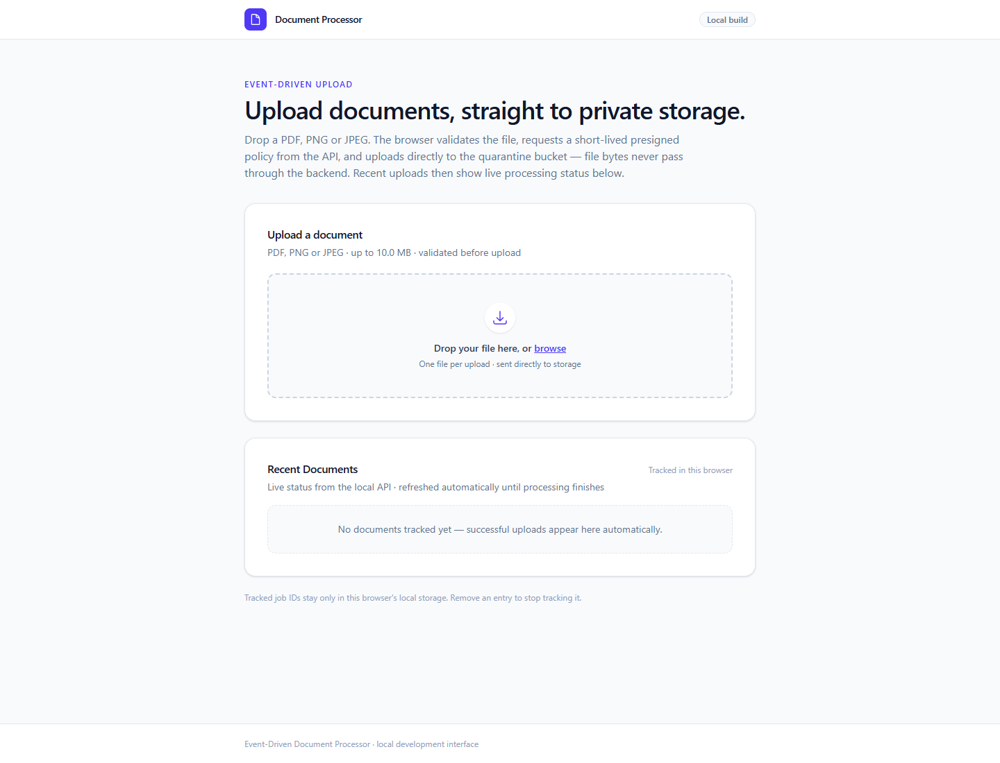
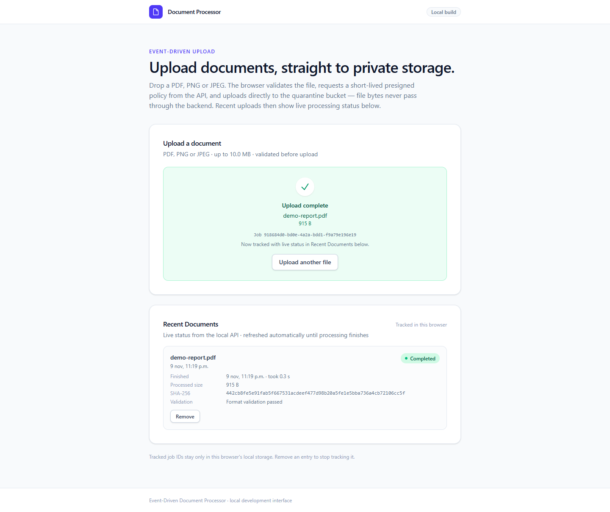
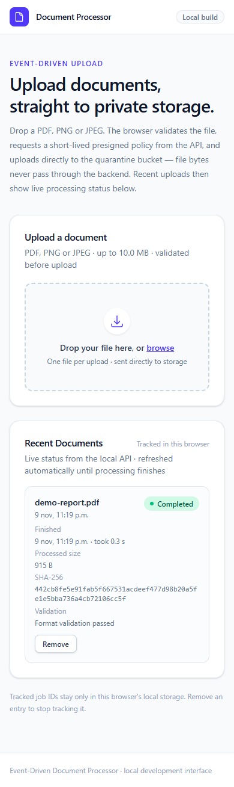
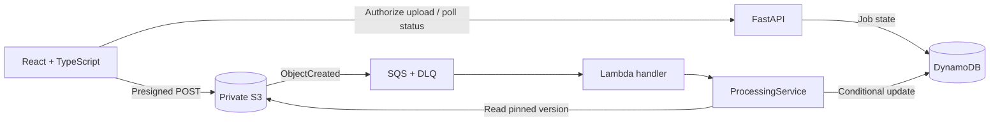

<div align="center">

# EventDriven Document Processor

**Direct uploads · Version-pinned processing · Retry-safe events**

A full-stack document processing application built with **Python, FastAPI, React, and AWS-compatible services**.
Upload documents, track their status, and inspect validation results through an event-driven pipeline.

[](https://github.com/RoCalderon1405/event_driven_document_processor/actions/workflows/ci.yml)
[](https://coveralls.io/github/RoCalderon1405/event_driven_document_processor?branch=master)
[](https://www.python.org/)
[](https://react.dev/)
[](docs/DEVELOPMENT.md)

[**Quick start**](#quick-start) · [**Architecture**](#architecture) · [**Features**](#key-features) · [**Testing**](#quality--testing) · [**Documentation**](#documentation)

</div>

---

## Overview

**EventDriven Document Processor** is a local-first application for uploading **PDF, PNG, and JPEG** files to private S3-compatible storage and processing them asynchronously through **S3 → SQS → Lambda → DynamoDB**.

Its React interface supports drag-and-drop uploads, progress indicators, job tracking, and processing metadata. The system is implemented and tested locally using **Floci**; it is **not deployed to AWS**.

## Application screenshots

Real Playwright captures of the local application, using a generated test PDF with no personal data.

### Document upload



### Completed processing

The same test PDF after the real S3 → SQS → Lambda → DynamoDB flow, with its SHA-256,
processed size, timing and validation result.



### Responsive mobile layout

The upload form and completed document at a 390 px viewport; the full SHA-256 wraps within the card.



## Why this project matters

Uploading a file is straightforward. Correctly handling **duplicate notifications, overwritten objects, retries, and worker failures** is harder.

- **Reliable processing** — conditional claims, leases, and fencing tokens protect results from concurrent and stale workers.
- **Clear architectural boundaries** — FastAPI and Lambda adapters share application use cases without coupling business logic to their transports.
- **Testable behavior** — integration tests exercise actual S3/SQS/Lambda events, content validation, recovery, and dead-letter delivery.

## Tech stack

**Frontend**


**Backend & validation**


**Event pipeline & local infrastructure**


**Developer experience & quality**


## Architecture



The backend follows **Clean Architecture**: adapters → application → domain, with infrastructure implementing ports and concrete dependencies wired in `bootstrap/`.

See the [architecture decision records](docs/decisions/) for the concurrency, storage, security, and event-processing trade-offs.

## Key features

| Capability | Implementation |
| --- | --- |
| **Direct browser uploads** | Private presigned S3 POST, client-side validation, and progress reporting |
| **Document tracking** | Job status polling, recent documents, and local browser history |
| **Processing results** | SHA-256, processed size, timestamps, duration, and failure codes |
| **Retry-safe execution** | Version-pinned reads, conditional claims, leases, and fencing tokens |
| **Content validation** | PDF/PNG/JPEG content checks; invalid formats end in `FAILED` |
| **Event resilience** | SQS retries, partial batch failures, and a dead-letter queue |
| **Automated checks** | Python and frontend quality gates plus isolated event-chain tests |

> [!IMPORTANT]
> **Local development only.** The API does not yet enforce authentication, document ownership, quotas, or rate limits. Format validation is **not** malware scanning. Do not expose this stack publicly.

## Quick start

**Prerequisites:** Docker Desktop with Linux containers and Docker Compose. To run Python tooling locally, use Python 3.14 and uv 0.13.6. For the frontend, use Node.js 24.

### 1. Start the standard API and storage stack

```bash
docker compose up --build -d --wait api
```

- **Swagger UI:** http://localhost:8000/docs
- **Floci gateway:** http://localhost:4566

The default stack supports document jobs and uploads but **does not consume S3 events**.

### 2. Run the full event-processing stack

```bash
docker compose -p eddp-lambda-probe -f compose.lambda.yaml --profile processing up --build -d processing-api
```

- **Event API:** http://localhost:8001/docs
- **Event Floci gateway:** http://localhost:4567

The event stack is isolated from the standard environment. See the [event-stack guide](infra/events/README.md) for setup, verification, and safe shutdown.

### 3. Start the React frontend

```bash
cd frontend
npm ci
npm run dev
```

Open **http://localhost:5173**. For end-to-end processing, configure Vite's `/api` proxy to target the event API at `http://localhost:8001` and follow the [frontend networking instructions](frontend/README.md).

### Main API endpoints

| Method | Endpoint | Purpose |
| --- | --- | --- |
| `POST` | `/api/v1/documents` | Create a metadata-only job |
| `POST` | `/api/v1/documents/uploads` | Create a job and authorize direct upload |
| `GET` | `/api/v1/documents/{job_id}` | Retrieve status and available processing results |

## Quality & testing

```bash
uv sync --locked
uv run python infra/ci/run.py quality
uv run python infra/ci/run.py docker
```

The quality gates include locked dependencies, Python tests, Ruff, isolated Docker integration, Lambda compatibility, and real event-chain checks. Frontend CI runs locked npm installation, linting, formatting, tests, and a production build.

The [CI workflow](.github/workflows/ci.yml) runs on pull requests and pushes to `master`. See [test evidence](docs/PROJECT_STATUS.md) for verified counts and the documented strict Floci SSE-metadata expected failure; see [coverage details](docs/COVERAGE.md) for Python and TypeScript coverage.

## Documentation

| Guide | Contents |
| --- | --- |
| [Development](docs/DEVELOPMENT.md) | Configuration, API examples, and local workflows |
| [Frontend](frontend/README.md) | React usage, networking/CORS, and component tests |
| [Event stack](infra/events/README.md) | S3/SQS/Lambda setup and verification |
| [CI](infra/ci/README.md) | Isolated gates, security boundaries, and reproducibility |
| [Coverage](docs/COVERAGE.md) | Coverage metrics and Coveralls configuration |
| [Architecture decisions](docs/decisions/) | Key implementation trade-offs |
| [Project status](docs/PROJECT_STATUS.md) · [Changelog](CHANGELOG.md) | Evidence, milestones, and history |

## Future improvements

- Authentication, authorization, ownership controls, rate limiting, and quotas before public use.
- Real AWS IAM, encryption, load, and failure testing.
- Cross-document SHA-256 deduplication (separate from implemented event idempotency).
- Optional webhooks, expanded observability, and DLQ recovery tooling.

---

<div align="center">

**Built to explore reliable, event-driven application design.**

[Back to top](#eventdriven-document-processor)

</div>
