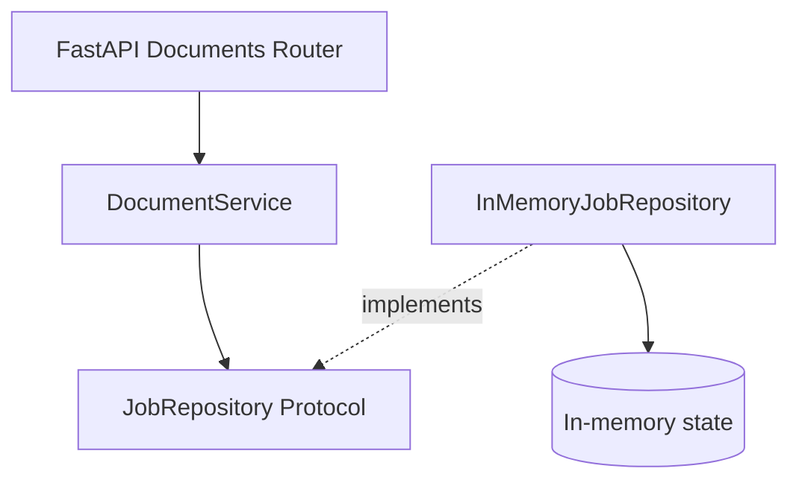

# EventDriven Document Processor

An event-driven document-processing API built with Python and FastAPI. The system is designed to accept direct S3 uploads, process documents asynchronously, and expose job status without coupling HTTP request handling to background processing.

## Implemented

- Versioned REST API with FastAPI and Pydantic validation
- Document job creation with UUID identifiers and UTC timestamps
- Job retrieval with explicit `404` and `422` responses
- Modular application, domain, and infrastructure boundaries
- Repository contract and dependency injection
- In-memory persistence for local API development
- Unit and HTTP integration tests

The current application creates **metadata-only jobs**. Files are not uploaded or processed yet. AWS services, callbacks, and distributed processing are planned, not implemented.

## Requirements

- Python 3.14+
- [uv](https://docs.astral.sh/uv/)

## Run

```sh
uv sync
uv run fastapi dev
```

API documentation: http://127.0.0.1:8000/docs

```sh
uv run pytest
uv run ruff check .
```

The lockfile is retained from the initial scaffold. Run `uv lock` on a network-enabled development machine, then commit the updated `uv.lock` alongside `pyproject.toml` to keep dependency resolution reproducible.

## API

### Create a document job

`POST /api/v1/documents`

```json
{
  "filename": "contract.pdf",
  "content_type": "application/pdf",
  "description": "Signed contract"
}
```

**201 Created**

```json
{
  "job_id": "550e8400-e29b-41d4-a716-446655440000",
  "filename": "contract.pdf",
  "content_type": "application/pdf",
  "description": "Signed contract",
  "status": "PENDING",
  "created_at": "2026-11-05T15:00:00Z"
}
```

The `job_id` and `created_at` values are generated on each request. `filename` is the canonical request field; `file_name` is also accepted for compatibility with earlier clients.

### Retrieve a job

`GET /api/v1/documents/{job_id}`

- `200 OK` — matching job
- `404 Not Found` — valid UUID without a matching job
- `422 Unprocessable Content` — malformed UUID or invalid request

### Health check

`GET /health`

## Design



The HTTP layer owns request validation and response schemas. The application service coordinates the creation and retrieval of jobs. Domain models remain independent of FastAPI and storage providers. The repository contract separates persistence requirements from the implementation.

The repository instance is shared within one Python process and protects its in-memory store with a lock. It is **not durable or distributed**: restarting the service loses stored jobs, and multiple server processes do not share state. DynamoDB will replace this adapter before introducing multiple workers.

## Next capabilities

1. Floci configuration and DynamoDB job storage
2. Presigned S3 uploads and S3 event notifications
3. SQS-driven Lambda/worker processing and document validation
4. SHA-256 deduplication, idempotency, retries, and DLQ
5. Reliable webhook delivery, structured logging, Docker, and CI

No AWS infrastructure has been deployed.
